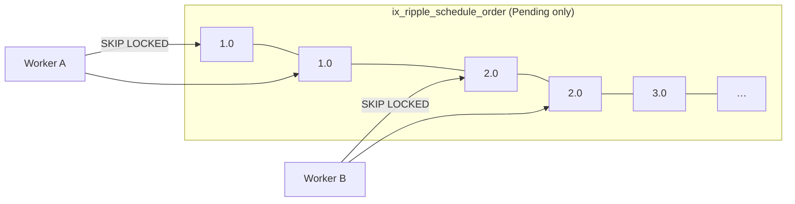

# The claim — one round trip, lowest `schedule_order` first

`EngineStore.PollAsync(limit, instanceId, executing, typeKeys)` is a **single statement** in one implicit
transaction:

```sql
with
  beat     -- (a) upsert this instance's heartbeat (runs even at limit 0 → polling IS liveness)
  claimed  -- (b) the globally lowest-schedule_order pending, retry-eligible ripples across ALL waves
           --     whose type_key this instance has a handler for (typeKeys; null = any),
           --     ORDER BY schedule_order, FOR UPDATE SKIP LOCKED, limit @limit;
           --     set Running, stamp claimed_by, attempt++
select …claimed ripples joined to their wave's shared payload…
```

## Why it's shaped this way

- **No runtime scheduling.** The fair-share is already in `schedule_order`, so the claim is just an index scan
  of `ix_ripple_schedule_order` — no quota, no counters. A poll's batch is heterogeneous: whatever the
  precomputed order interleaves.
- **Handler affinity.** The one type filter is "types I can run". A worker missing a handler (rolling deploy,
  type-dedicated pools) leaves that type `Pending` for a peer instead of claiming it and burning its attempts.
- **`SKIP LOCKED`** means N workers polling the same queue take **disjoint** slices without blocking — cluster
  throughput scales with instance count.
- **The heartbeat rides on the poll.** A poll at `limit 0` still beats; the dispatcher falls back to a direct
  beat only if a poll throws. Every poll is bounded by a deadline derived from the heartbeat settings —
  $(\text{HeartbeatTimeout} - \text{HeartbeatInterval}) / 4$, 3s at the defaults — so one slow claim can't
  get a live instance declared dead. The beat continues through the shutdown drain.
- **The claim is slim** — it returns only what execution needs plus the wave's shared payload, joined in the
  same query, so the big per-ripple payloads travel once.
- **Retry-eligibility** is `next_attempt_at is null or next_attempt_at <= now()`; a backing-off ripple keeps
  its early `schedule_order`, so once eligible it re-claims at its original queue position.



All workers claim off the same left edge of the index; `SKIP LOCKED` keeps them disjoint.
