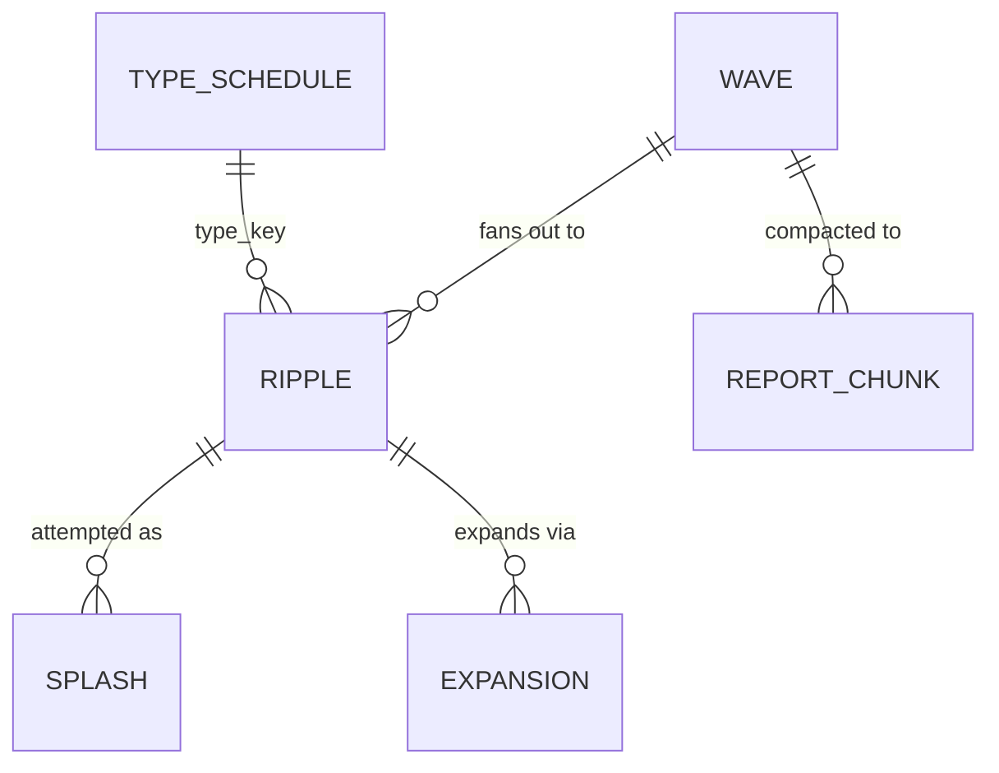
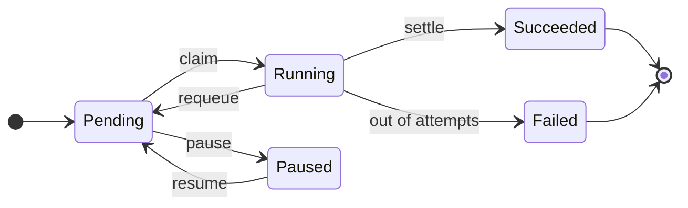

# Data model

Everything lives in the `ripple` schema — one FluentMigrator migration (`Storage/Migrations/M0001_Schema.cs`),
a single authoritative `CREATE` while the database is ephemeral at POC stage. Hot paths are served by
**partial indexes** that hold only the small working set, never the settled millions.

| Table | Role | Hot? |
|---|---|---|
| `wave` | one small row per job: shared payload, `status`, `ripple_count`, and its **recomputed** `pending`/`running`/`paused`/`failed`/`retry_count` (+`refreshed_at`) | fan-out / completion + the periodic refresh |
| `ripple` | the huge table: one row per task, with `state`/`attempt`/`type_key`/`schedule_order`/payload | yes → partial indexes |
| `splash` | one row per execution attempt: outcome, per-target `report` jsonb, claimed/started/ended, duration | append-only |
| `instance_heartbeat` | cluster membership: `last_seen_at`, `executing` | tiny |
| `type_schedule` | per-`type_key` config: `batch_size`, `gap_seconds`, `max_attempts` | tiny, read at fan-out + claim |
| `expansion` | in-flight expansion ledger, keyed `(parent_ripple_id, expansion_key)` | deleted at compaction |
| `report_chunk` | a finished wave's aggregated per-target report | kept for the wave's retention |

## Ripple states

Ripples flip a `state` flag; they don't move between tables.

| Transition | When |
|---|---|
| → `Pending` | created by fan-out or expansion |
| `Pending → Running` | claimed; `attempt` is bumped |
| `Running → Pending` | failed with retries left (backoff via `next_attempt_at`), owner died (recovery), or released at shutdown |
| `Running → Succeeded` | the attempt settled successfully |
| `Running → Failed` | failed on its last attempt (`max_attempts`), or poison-failed by recovery |
| `Pending ⇄ Paused` | the ripple's type was paused / resumed (reconciled in bounded chunks) |
| `Succeeded` / `Failed` → gone | the wave went terminal and was compacted |

## Key modelling choices

- **Nothing counts on the hot paths.** The claim, settlement, and recovery change only `ripple.state`. The
  wave's numbers are recomputed periodically from the actual rows, so they **self-heal**. `succeeded` is never
  stored — derived as `ripple_count − pending − running − paused − failed`.
- **Completion is "no pending, no running and no paused"**, not "count reached" — parked work of a paused
  type holds the wave open. `ripple_count` keeps growing as handlers
  expand the wave, so the original count can't signal completion.
- **`schedule_order` is a precomputed ordering key, not a deadline.** Stamped once at fan-out and never
  rewritten (except by an explicit operator reschedule).
- **There is no `Ripple` CLR type.** A ripple is just a row; the claim returns a lightweight `ClaimedRipple`.
- **Settled rows don't accumulate.** When a wave goes terminal, compaction rolls its splashes into
  `report_chunk` rows and deletes its ripples + splashes; retention later purges the wave itself.
