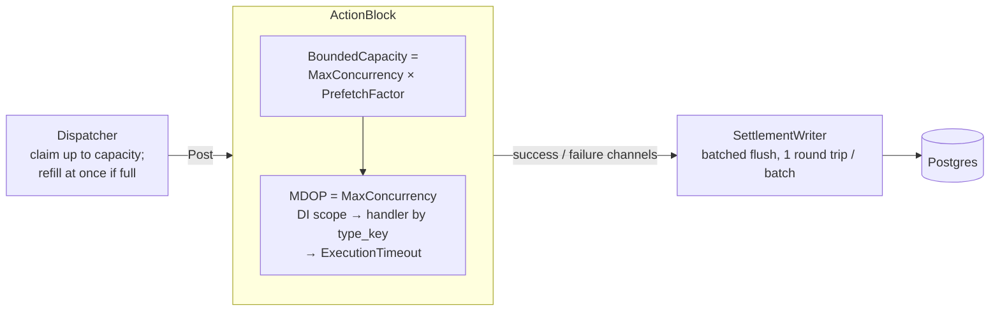

# Execution — the TPL pipeline and back-pressure

`ExecutionPipeline` runs claimed ripples through a single bounded `ActionBlock<PreparedRipple>` and owns the
shutdown drain. It delegates three things: which attempts this instance owns (`InFlightTracker`), whether a
failed attempt retries and when (`IRetryPolicy`, default `ExponentialRetryPolicy`), and writing outcomes in
batches with retry (`SettlementWriter`).

- **MDOP vs depth.** Execution parallelism is `MaxConcurrency`, but the block's `BoundedCapacity` is
  `MaxConcurrency × PrefetchFactor` (default 2). The dispatcher **prefetches** a queue in front of the block, so
  a finishing slot immediately starts queued work — without it, execution sawtooths 0↔cap and averages a small
  fraction of the cap. The dispatcher polls again *at once* when it filled its capacity.
- **Back-pressure.** A ripple counts as "in flight" from claim until its outcome is **durably settled**, not
  merely executed. A stalled settlement keeps the in-flight count high, collapses claim capacity to zero, and
  pauses the dispatcher — which also bounds the in-memory settlement buffers.
- **A handler that won't stop is abandoned, not waited for.** `ExecutionTimeout` only *cancels* the token.
  `HandlerCancellationGrace` after the cancel, the attempt is recorded Failed (and retried), the slot is freed,
  and `ripple.abandoned` counts it. Handlers run via `Task.Run`, so a synchronously-blocking one is covered too.
- **Shutdown releases what it interrupts.** A handler cancelled because `ShutdownDrainGrace` ran out goes back
  to `Pending` at once with **the attempt handed back** and an `Abandoned` splash — a restart can't spend a
  ripple's retries. A hard-killed process still goes through recovery, which does count the attempt.
- **Outcome handling.** The attempt fails if the handler throws **or** reports any Failed target; it then
  retries with exponential backoff until the type's `max_attempts`, then goes terminal. The resolved items are
  persisted as the splash's `report` jsonb.

If the execute block itself **faults**, the `Dispatcher` releases all its claims and calls
`StopApplication()` to fail fast, rather than silently abandoning rows as `Running`.
