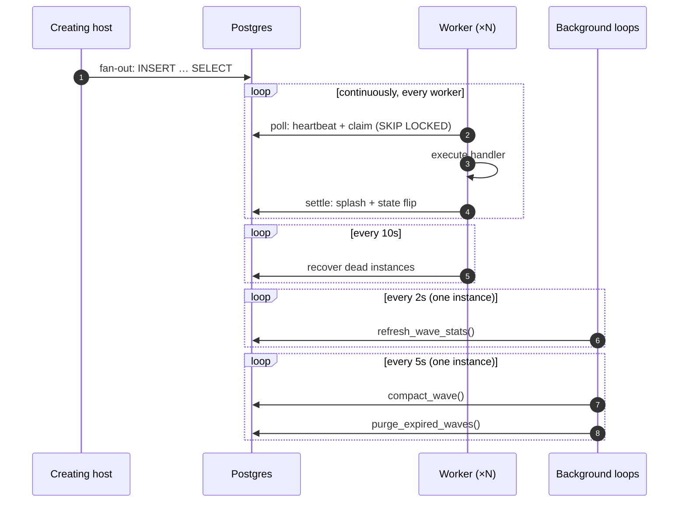
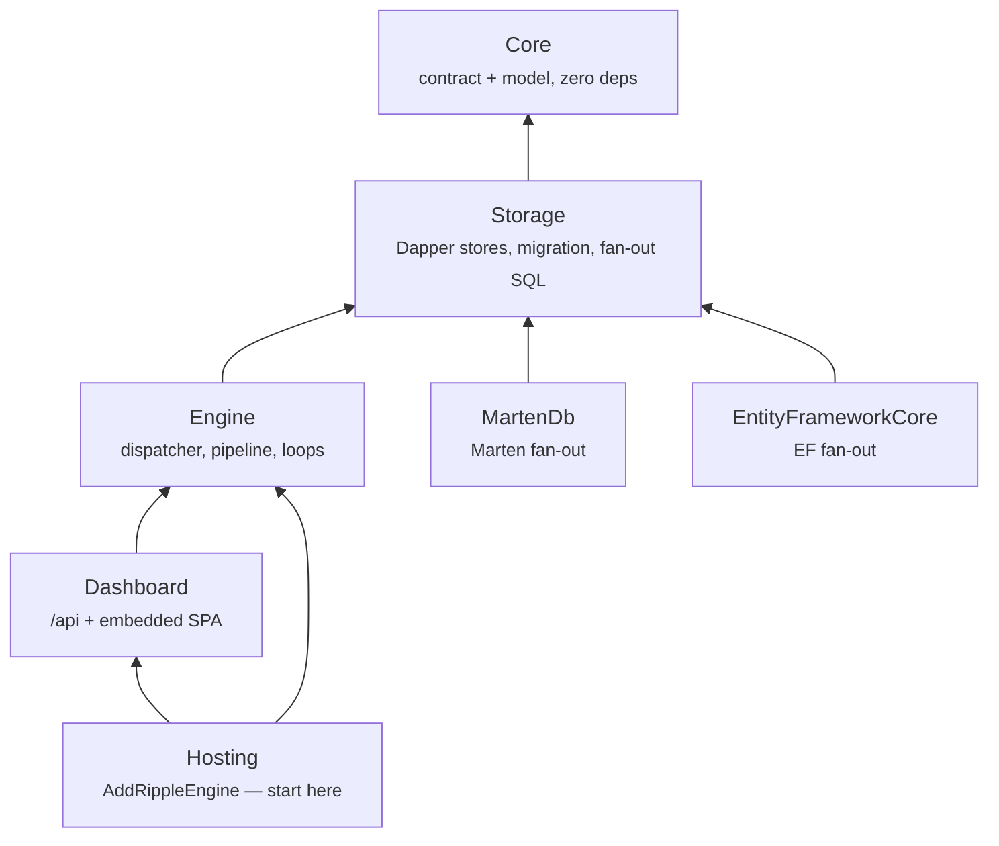

# Architecture overview

RippleEngine is a **self-contained, in-process distributed job engine**: .NET hosted services + TPL Dataflow +
raw Postgres (Dapper). The database is the only source of truth; instances coordinate purely through it —
`FOR UPDATE SKIP LOCKED`, a precomputed `schedule_order` ordering key, a periodically-recomputed stats table,
and heartbeats. There is **no message broker**, no scheduler service and no leader.

## Lifecycle

## The stages

| # | Stage | Where | Page |
|---|---|---|---|
| 1 | **Fan-out** — one server-side `INSERT … SELECT` | `WaveBuilder` / `WaveInsertSql` | [Fan-out](/architecture/fan-out) |
| 2 | **Schedule** — fair-share baked into `schedule_order` | `ScheduleOrderSql` | [Scheduler](/architecture/scheduler) |
| 3 | **Claim** — one round trip, lowest key first | `EngineStore.PollAsync` | [Claim](/architecture/claim) |
| 4 | **Execute** — bounded TPL pipeline, back-pressure | `ExecutionPipeline` | [Execution](/architecture/execution) |
| 5 | **Settle** — a fenced state flip + splash | `SplashStore` | [Settlement & recovery](/architecture/settlement-and-recovery) |
| 6 | **Recover** — dead and self-stranded claims | `RecoveryLoop` | [Settlement & recovery](/architecture/settlement-and-recovery) |
| 7 | **Stats + completion** — periodic recompute | `refresh_wave_stats()` | [Stats & completion](/architecture/stats-and-completion) |

## Solution layout

The core has zero dependencies; the two fan-out providers are interchangeable siblings over the same Core
abstractions.

| Project | What |
|---|---|
| `x86cc.RippleEngine.Core` | the developer contract + model (`IRippleHandler`, `IRippleTarget`, `SplashReport`, builder/generator interfaces, `Wave`) |
| `x86cc.RippleEngine.Storage` | the coordination surface — Dapper stores (claim, settle, recover, stats, compaction, pause), the schema migration, the shared fan-out SQL |
| `x86cc.RippleEngine.Engine` | the runtime — dispatcher, TPL pipeline, recovery, stats refresh, compaction, pause reconciliation, handler registry, metrics |
| `x86cc.RippleEngine.MartenDb` | the Marten-source `INSERT…SELECT` fan-out provider |
| `x86cc.RippleEngine.EntityFrameworkCore` | the EF-Core-source fan-out provider |
| `x86cc.RippleEngine.Dashboard` | `/api` read projections + the Angular SPA, embedded in the assembly |
| `x86cc.RippleEngine.Hosting` | the one entry point: `builder.AddRippleEngine(o => …).AddHandler<…>()` |
