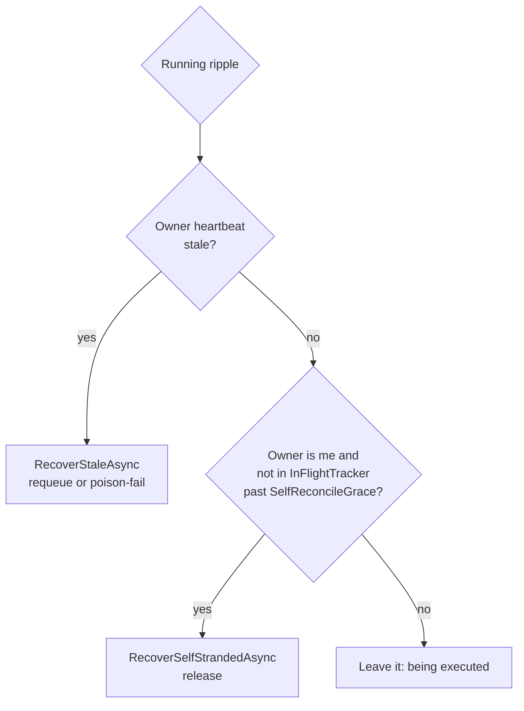

# Settlement & recovery

## Settlement — a fenced state flip

`SplashStore.CompleteRipplesAsync` / `FailRipplesAsync` are batched, one round trip each:

1. **Fenced state flip:**

   ```sql
   update ripple.ripple r set state = …
   from unnest(@ids, @attempts) u(id, attempt)
   where r.id = u.id
     and r.claimed_by = @me
     and r.state = 'Running'
     and r.attempt = u.attempt
   returning …
   ```

   Only rows still `Running`, *owned by us*, and *on the attempt this outcome came from* move. A
   wrongly-declared-dead instance's late write no-ops instead of resurrecting a reclaimed ripple.

2. **Splash rows** — one `unnest(...)` insert for the whole batch, only for ripples that actually transitioned.

:::info Why the attempt is part of the fence
Owner + state alone don't identify an attempt. An instance that stalls past `HeartbeatTimeout` has its work
reclaimed, then resumes under the *same* `InstanceId` and can re-claim the very ripple it stalled on. Its stale
attempt-1 outcome would find `claimed_by = me` and `state = 'Running'` both true of attempt 2 — and settle it
out from under a still-running handler.
:::

Requeues flip to `Pending` with a per-ripple `next_attempt_at` backoff and keep their `schedule_order`. The
splash's `duration_ms` comes from an `EndedAt` stamped when the handler finished, so batching and retry backoff
aren't folded into it.

**A write the database rejects is isolated, not retried as-is.** `SettlementWriter` retries an *outage*
(connection lost, timeout, transient SQLSTATE) as a whole batch with backoff. A *rejection* — something in the
batch's data — would fail forever, so the batch is split until the offending outcome is alone, and that one
settles with a placeholder report naming the reason.

There are **no counters and no completion check** here — that's the [stats refresh](/architecture/stats-and-completion).

## Recovery — surviving a dead instance

`RecoveryLoop` (every `RecoveryInterval`, ~10s, on every instance) calls `EngineStore.RecoverStaleAsync`, one
statement:

1. `dead` — instances whose heartbeat is older than `HeartbeatTimeout`, **excluding self**.
2. `moved` — their `Running` ripples, fenced on `state = 'Running'`: requeued to `Pending` (keeping
   `schedule_order`), or **poison-failed** if they've exhausted `max_attempts` — the attempt is bumped at claim,
   so a process-killing ripple can't loop forever.
3. `abandoned` — an `Abandoned` splash per reclaimed ripple, so an outcome-less attempt is *explained*.
4. `prune` — the dead heartbeat rows.

It's idempotent and nearly free when healthy.

### Self-stranded claims

Dead-owner recovery can't rescue work a **live** instance stranded itself — a claim that never reached a
handler, or a poll abandoned after its claim committed. `RecoverSelfStrandedAsync` (same loop) reclaims rows the
database says are `Running & claimed_by = me` but whose ids aren't in `InFlightTracker`, past a
`SelfReconcileGrace` window that covers the claim → enqueue gap.

The two sweeps fail independently: if one throws, it is logged and the other still runs in the same tick, so
a dead-instance sweep that keeps failing can't block the only path that rescues a live instance's own claims.


