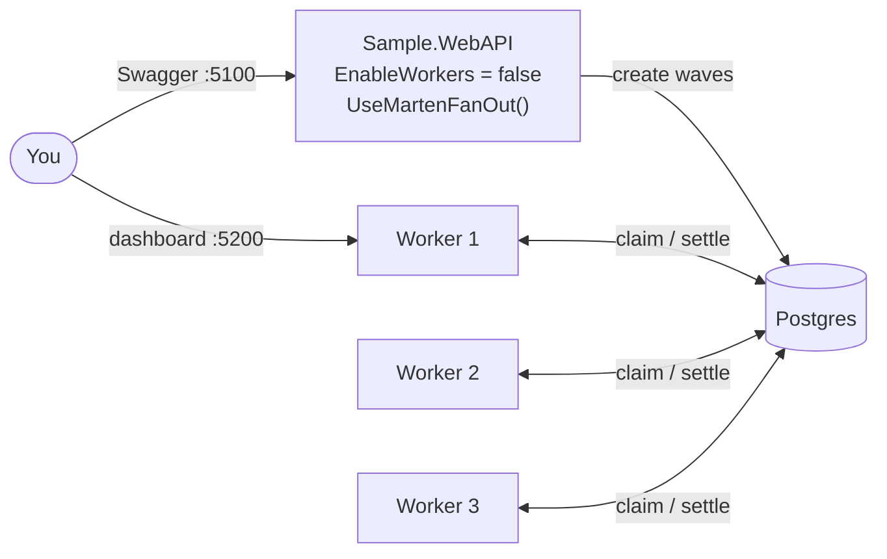

# Run the sample end-to-end

The repo ships a runnable [Aspire](https://aspire.dev) sample — Postgres, a Swagger WebAPI, and **3 competing
Worker replicas** — around a company/government-taxation scenario:

```bash
dotnet run --project x86cc.Ripple.Sample.AppHost
```

Two minutes of it: waves triggered from Swagger, then watched, rescheduled, paused and resumed from the dashboard.

<video controls muted playsInline preload="metadata" poster="/video/ripple-demo.jpg" src="/video/ripple-demo.mp4" style={{width: '100%', borderRadius: 12}}></video>



Open the **Aspire dashboard**, then the **WebAPI's Swagger UI** (`:5100`), and drive it:

1. `POST /seed?total=1000000&batchSize=5000` — a *seed wave* generates 1M companies (Bogus + Marten
   `BulkInsert`), linking them to tax codes with **exact** sizes (`TAX-1K`, `TAX-10K`, `TAX-100K`, …). Add
   `&sizeKb=300` for very large aggregates. This one uses the in-memory generator: its ripples are index
   ranges, not existing rows.
2. `GET /tax-codes` — see the codes and their populated counts.
3. `POST /corporate-tax?taxCode=TAX-100K&rate=0.23` — a *taxation-change wave* fans out one ripple per
   impacted company and recomputes its tax. `POST /employee-tax?…` is a second, competing job type,
   registered at 3× the batch size, so you can watch the two interleave at a ~3:1 share.
4. `GET /waves/{id}` — watch it drain to `Completed`; `GET /engine/instances` — the true live cluster
   concurrency. Or open a **worker's** URL (`:5200`) for the [dashboard](/operations/dashboard).

The `Sample.E2ETests` project drives all of this through the Aspire host to **measure throughput, concurrency
smoothness, and fair-share between job types** — run them manually with `dotnet test --filter …`.

:::tip Rebuild after engine edits
`dotnet run --no-build --project <sample>` uses that project's **own** `bin/` copy of the engine DLLs. After
editing `Engine`/`Storage`, rebuild the whole solution (or the sample project), or standalone runs silently
execute the old engine.
:::
