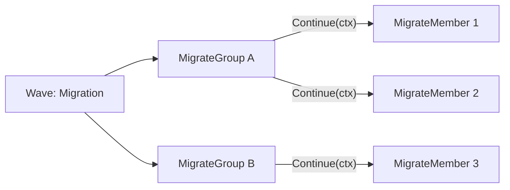

# In-flight expansion

A coarse ripple can discover its own children without loading them: `Continue(context)` appends ripples to the
wave the current ripple belongs to, parented to it.

```csharp
public async Task<SplashReport?> Execute(Migration wave, MigrateGroup ripple, IRippleContext ctx)
{
    await using var session = store.LightweightSession();
    await martenGenerator                                              // or efGenerator / collectionGenerator
        .Continue(session, ctx)                                        // same wave, parented to this ripple
        .AddRipples<Member, MigrateMember>(m => m.GroupId == ripple.GroupId,
                                           m => new MigrateMember { Id = m.Id })
        .DispatchAsync(ctx.CancellationToken);
    return null;
}
```

- The children are **appended after the wave's own tail** in the schedule, so the job stays FIFO internally.
- The wave's `ripple_count` grows, and the wave **cannot complete until the children settle**.
- `parent_ripple_id` records the lineage for auditing.



## Expansion is made once

The children commit in their own transaction, *ahead* of the parent's outcome. So an attempt that expands and
then fails would leave its children behind, and the retry would add a second set. A handler has no way to know
it already expanded — so the engine guarantees it:

1. **Ledger** — each expansion is recorded in `ripple.expansion` per `(parent ripple, expansion key)`. A repeat
   inserts nothing and returns the wave as it stands. **First attempt wins.**
2. **Fence** — just before commit, the parent must still be `Running` on the expanding attempt, else the
   dispatch throws and rolls back. That refuses a late `Continue` from an abandoned handler or a stalled
   instance whose work was already recovered.

The key defaults to the ordinal of the `Continue` call within the attempt (`#1`, `#2`, …). That's stable for a
handler that expands in the same order each attempt; **one whose expansion order varies must pass an explicit
key**:

```csharp
await martenGenerator.Continue(session, ctx, expansionKey: $"members:{ripple.GroupId}")
    /* … */;
```

## Concurrency

Fan-outs appending to the same wave are serialised per wave + ripple type (a transaction-scoped advisory lock),
so N handlers expanding one wave at once don't stack their children on the same schedule slots. The price is
that same-type expansions of one wave insert one at a time.
