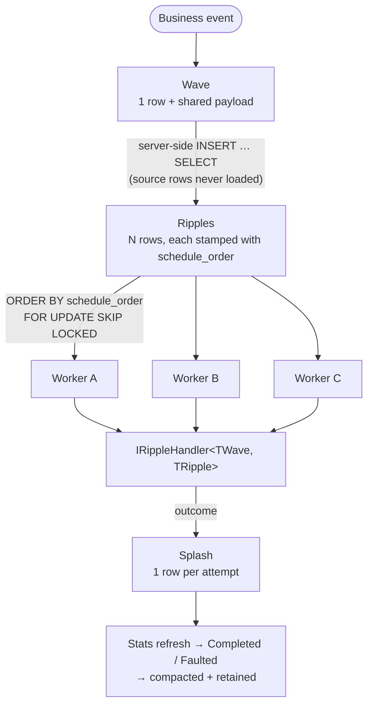

# Ripple

**Turn one business event into millions of per-entity tasks — without ever loading the source rows into your
app, and without a message broker.**

Ripple is a .NET library for **massive, set-based fan-out** over a Postgres store. A single event
("the corporate tax rate changed", "this legislation now applies", "re-index everything in region X") spawns
200k–10M+ per-entity tasks that a cluster of identical worker processes then executes — with retries,
fair-share scheduling, crash recovery, back-pressure, and a live dashboard — coordinating **entirely through
the database**. No broker, no scheduler service, no leader election.

You implement exactly one interface, `IRippleHandler<TWave, TRipple>`. The engine owns everything else.

<video controls muted playsInline preload="metadata" poster="/video/ripple-demo.jpg" src="/video/ripple-demo.mp4" style={{width: '100%', borderRadius: 12}}></video>

## The problem it solves

When one event impacts a huge set of entities, the obvious approach doesn't scale:

> load every impacted row into the app → enqueue a message per row → let workers consume them.

That round-trips millions of rows through your process and a broker just to say "recompute this one". Memory,
serialization, and broker throughput all become the bottleneck before any real work happens. And once the
backlog exists, one giant job starves every other job behind it.

Ripple does the fan-out **inside Postgres**. `AddRipples(predicate, toMessage)` compiles to a single
server-side `INSERT INTO ripple.ripple … SELECT … FROM <your table> WHERE <predicate>` — one statement that
creates a task row per impacted entity **without the source rows ever leaving the database**. Workers then
pull tasks straight from Postgres with `FOR UPDATE SKIP LOCKED`, in an order that already encodes each job's
fair share.

## Vocabulary (water theme)

| Term | Is | Lives in |
|---|---|---|
| **Wave** | a job — one triggering event, carrying a shared payload | one `ripple.wave` row |
| **Ripple** | a task — one per target entity, carrying its own payload | rows in `ripple.ripple` |
| **Splash** | one execution attempt — the audit record | rows in `ripple.splash` |

## What you get

- **Server-side fan-out** — 400k tasks materialised by one SQL statement, from a **Marten** LINQ query, an
  **EF Core** query, or an in-memory collection. Same builder API for all three.
- **Batch-interleaving fair-share** — each task's queue position (`schedule_order`) is precomputed at fan-out
  from a per-type `(batch_size, gap_seconds)`, so competing jobs **interleave** and a 10M-row backlog can't
  starve a small, urgent job.
- **A cluster of symmetric workers** — every instance claims, executes, settles, recovers and refreshes;
  `SKIP LOCKED` keeps their claims disjoint, so throughput scales with instance count.
- **In-flight expansion** — a handler can grow the wave it belongs to (`Continue(context)`); the wave won't
  complete until the children settle.
- **Retries with backoff**, **crash recovery** via heartbeats, and **back-pressure** so the poller never
  outruns execution.
- **Batch-aware outcomes** — `SplashReport` records per-target results, aggregating identical outcomes so 200k
  successes collapse to one row.
- **No hot counter rows** — progress and completion are recomputed from the task rows, so the hot paths never
  contend and the numbers self-heal.
- **The hot tables stay small** — finished waves are compacted into report chunks, then purged after a
  per-wave-type retention.
- **Pause / resume a job type** at runtime, drained asynchronously in bounded chunks.
- **Operability** — an Angular dashboard plus OpenTelemetry metrics and tracing, tagged by type.

## Where to go next

- **[Quick start](/getting-started/quick-start)** — define a handler, wire the engine, fan out a wave.
- **[Guides](/guides/handlers)** — handlers, fan-out sources, in-flight expansion, configuration.
- **[Architecture](/architecture/overview)** — how the fan-out, scheduler, claim, settlement and recovery work.
- **[Operations](/operations/dashboard)** — the dashboard, metrics and tracing, the
  [production checklist](/operations/production), and the known limits.

## Status

The mechanism is complete and covered by the engine test suite plus a whole-system throughput suite that seeds
10M entities through the engine itself. It is **pre-1.0**: consumed by project reference and not yet run in
production. See [Known limits](/operations/known-limits) for the deliberate trade-offs.
