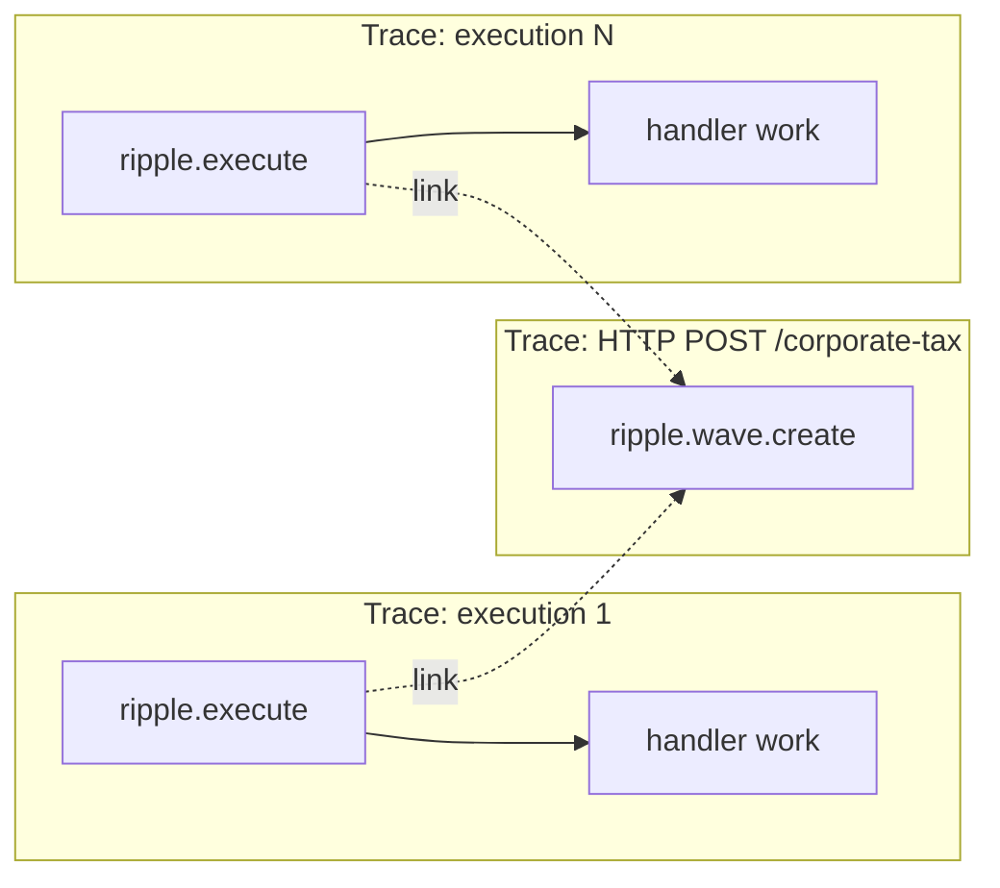

# Metrics & tracing

## Metrics

`RippleMetrics` publishes on a BCL `Meter("x86cc.RippleEngine")`, inert without a listener.
`o.EnableMetrics = true` adds it to OpenTelemetry and exports over OTLP when `OTEL_EXPORTER_OTLP_ENDPOINT` is
configured. A host with its own setup can add the meter by name: `AddMeter("x86cc.RippleEngine")`.

| Instrument | Kind | Tags | Meaning |
|---|---|---|---|
| `ripple.claimed` | counter | `type_key` | ripples claimed |
| `ripple.succeeded` | counter | `type_key` | attempts that succeeded |
| `ripple.failed` | counter | `type_key` | attempts that failed |
| `ripple.duration` | histogram | `type_key` | handler execution time |
| `ripple.executing` | gauge | — | in-flight on this instance |
| `ripple.recovered` | counter | `reason` (`dead_instance` / `self_stranded`) | ripples reclaimed by recovery |
| `ripple.abandoned` | counter | — | handlers that ignored cancellation |
| `ripple.released` | counter | — | ripples handed back at shutdown |
| `ripple.settlement.retries` | counter | — | settlement writes retried after an outage |
| `ripple.settlement.rejected` | counter | — | outcomes the database rejected (isolated) |
| `ripple.poll.duration` | histogram | — | claim round-trip time |
| `ripple.queue.depth` | gauge | — | pending ripples across active waves (cluster-wide) |

The queue gauge is sampled every `QueueMetricsInterval` (15s) by `QueueMetricsLoop`; every instance reports
the same series, and nothing is read while no one listens.

## Tracing

`o.EnableTracing = true` — on the creating host **and** the workers — publishes an `ActivitySource` of the same
name (`AddSource("x86cc.RippleEngine")` for a host with its own setup):

| Span | Is |
|---|---|
| `ripple.wave.create` | the fan-out |
| `ripple.wave.expand` | an in-flight `Continue` |
| `ripple.execute` | one attempt of one ripple |

An execution is a **root span linked** to the trace that created its wave — not a child of it. One event
becomes up to millions of executions over hours, which as children would be a single trace no backend can hold,
sampled all-or-nothing. The link target is the wave's `trace_parent` column, captured at creation. A handler's
own work, including its expansion, nests under its execution span.

:::tip Sample executions
Executions are numerous — configure a sampler for `ripple.execute`.
:::
